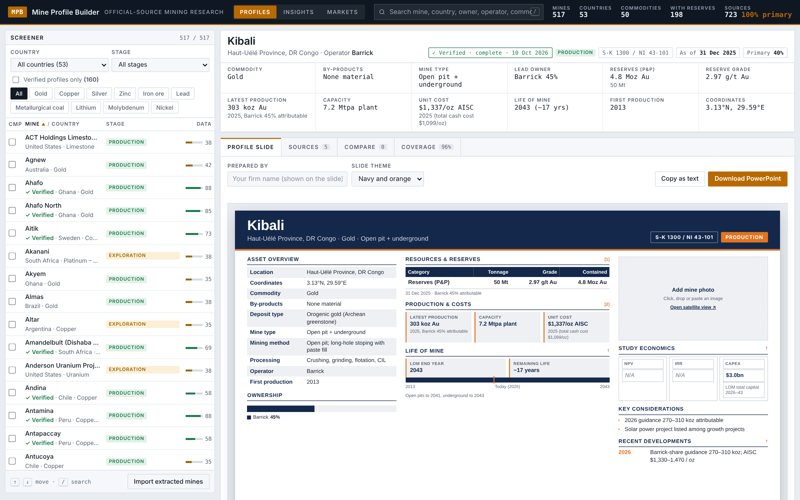
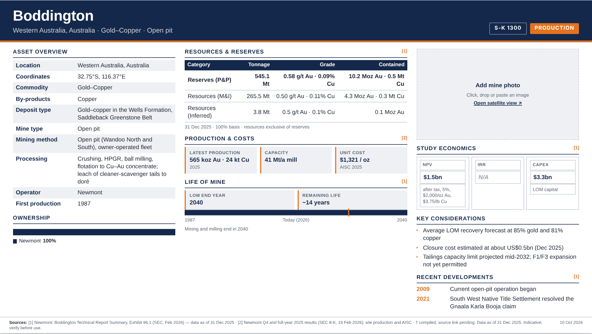
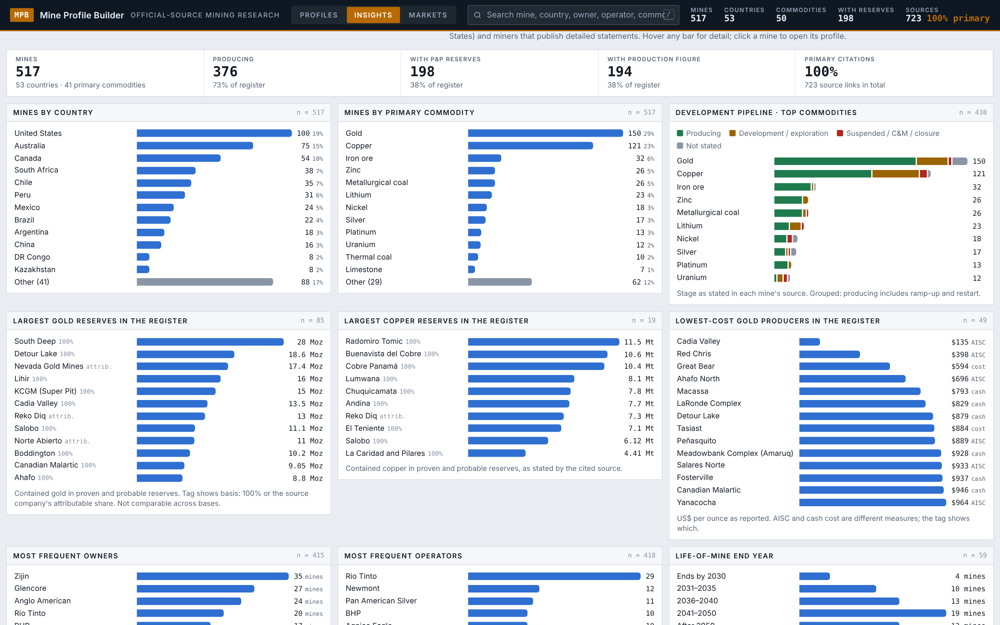
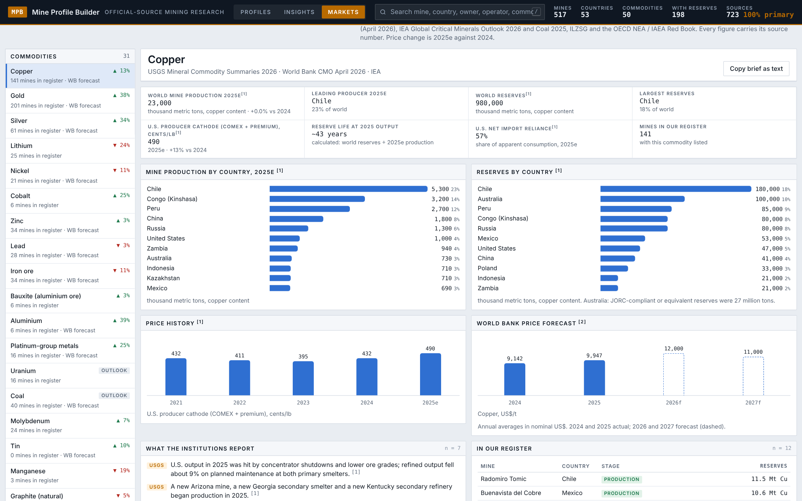

# Mine Profile Builder

**Pick any mine and get a clean, source-backed one-slide profile in minutes, built only from official filings.**

> **This repository is a showcase.** The full tool and the 517-mine dataset are private. A live walkthrough is available on request.

> 🚧 **Work in progress.** The register already covers 517 mines across 53 countries. See the [Roadmap](#roadmap) for what's next.



---

## The problem

Analysts covering mining companies often need a quick snapshot of a single asset: who owns it, how big it is, what it costs to run, and how long it will last. Getting that means opening a 200–400 page technical report (S-K 1300, NI 43-101, JORC) or an annual report, finding the right tables, and retyping the numbers into a slide.

Done by hand, that takes **~1.5–2 hours per mine**. It has to be redone every time a new report comes out, and every analyst formats the output differently.

## What it does

Mine Profile Builder is a research workspace with three views.

### 1. Profiles
- **Screener:** search and filter 517 mines by commodity, country and stage. Sort columns and tick mines for comparison.
- **One-slide profile:** every mine follows the same outline, so profiles can be compared side by side:

| Section | What it shows |
|---|---|
| Asset Overview | Location, commodity, deposit type, mine type, mining method, processing |
| Ownership | Owners and stakes, shown as a bar, plus operator |
| Resources & Reserves | Tonnage, grade and contained metal by category, with the as-of date |
| Life of Mine | Remaining mine life and start year |
| Production & Costs | Annual output and unit costs, where reported |
| Study Economics | NPV, IRR and capex from the latest technical study, where available |
| Key Considerations | Short analyst-style notes on what matters for the asset |
| Recent Developments | Dated timeline of material events |

- **Sources & verification:** every figure is footnoted to its filing and section. Reserve rows are cross-checked (tonnes × grade must match contained metal), and each mine carries a verification log.
- **Compare:** put selected mines next to each other and export a comparison slide.
- **Export:** download the profile as **PowerPoint**, the data as **CSV**, or copy it as text.

**Example output: one-slide profile (Boddington, Australia)**



### 2. Insights
Charts computed live from the whole register:
- Mine stage pipeline by commodity (producing, development, suspended)
- Most frequent owners and operators, including state ownership
- Largest gold and copper reserve holders in the register
- Spread by country and commodity
- Lowest-cost gold producers and life-of-mine end years



### 3. Markets
One brief per commodity (31 commodities), built only from official sources: USGS Mineral Commodity Summaries 2026, World Bank Commodity Markets Outlook, IEA Global Critical Minerals Outlook, ILZSG and the OECD NEA / IAEA Red Book. Each brief covers price trend, top producing countries and outlook, links back to the mines in the register, and cites every figure.



## Time saved

| | Manual | Mine Profile Builder |
|---|---|---|
| One mine profile | ~1.5–2 hours | Minutes |
| Consistent format across mines | Depends on the analyst | Same outline every time |
| Source for every number | Often skipped | Built in, with verification log |

## Coverage today

- **517 mines** in **53 countries**, 376 of them producing
- **723 source links** to the underlying filings; **160 profiles** fully verified
- **50 commodities:** gold, copper, silver, zinc, iron ore, lead, metallurgical and thermal coal, lithium, nickel, uranium, PGMs and more
- **31 commodity market briefs**

## How it works

```
Official filings (SEC EDGAR · company reports · technical reports)
        │
        ▼
AI-assisted extraction into a fixed mine schema
        │
        ▼
Verification: figures checked against the cited section,
reserve arithmetic cross-checked (tonnes × grade = contained metal)
        │
        ▼
Register (screener · insights · markets)
        │
        ▼
One-slide profile → PowerPoint / CSV export
```

**Built with:** HTML, CSS and JavaScript · PptxGenJS for PowerPoint export · Claude (AI) for extracting data from filings

## Samples

Three fully verified sample profiles, each a different commodity:

| Mine | Country | Commodity | Slide |
|---|---|---|---|
| Oyu Tolgoi | Mongolia | Copper–gold | [view](samples/oyu-tolgoi.png) |
| Boddington | Australia | Gold–copper | [view](samples/boddington.png) |
| Greenbushes | Australia | Lithium | [view](samples/greenbushes.png) |

[`samples/sample_mines.json`](samples/sample_mines.json) holds the same three records in the tool's data format, including source links and the verification log (figures checked against their cited section, plus the tonnes × grade arithmetic check).

## Data sources

Official, publicly available sources only:
- **SEC EDGAR** (S-K 1300 technical report summaries, 10-K and 20-F filings)
- **Company** annual reports, technical reports and websites
- **USGS, World Bank, IEA, ILZSG, OECD NEA / IAEA** for market data

Original reports are linked, not redistributed. A handful of early profiles still carry secondary references, which are being replaced with primary sources.

## Roadmap

- [x] Fixed one-slide outline for every mine
- [x] 500+ mine register with screener, filters and compare
- [x] Source footnotes and verification log
- [x] PowerPoint and CSV export
- [x] Insights and commodity market briefs
- [ ] Automated pipeline: upload a new technical report and get a profile
- [ ] Refresh alerts when a mine publishes a new report
- [ ] Verification log for every mine in the register
- [ ] Peer benchmarking (cost curves, reserve life)

## Limitations

- Figures are only as current as each mine's latest published report.
- Coverage leans toward SEC filers and companies that publish detailed reports.
- Some fields aren't disclosed for every mine, and those are shown as not available.
- Not investment advice.

## About

Built by **Ninad**, who spent 4+ years in investment banking research and now builds AI-assisted tools that turn hours of manual research into minutes.

[LinkedIn](https://linkedin.com/in/[your-profile])

---

© 2026 Ninad. All rights reserved. See [LICENSE](LICENSE).
